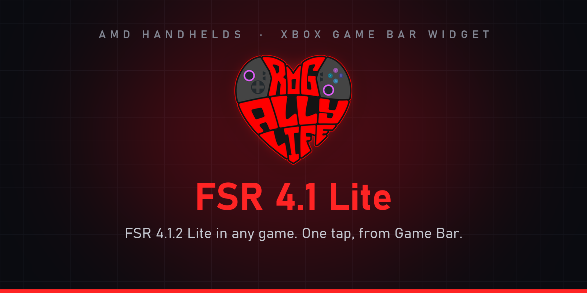
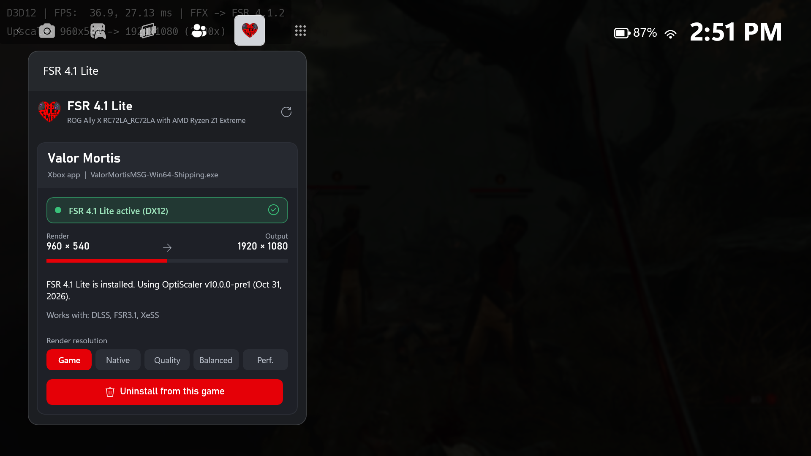
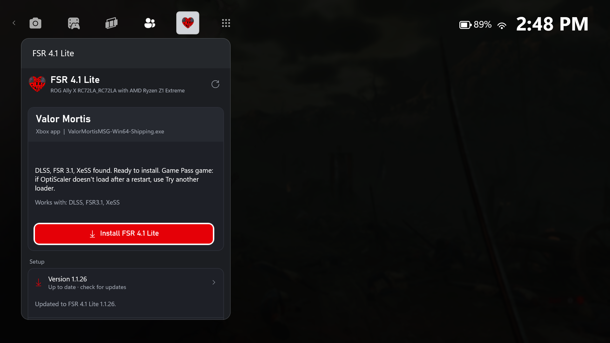
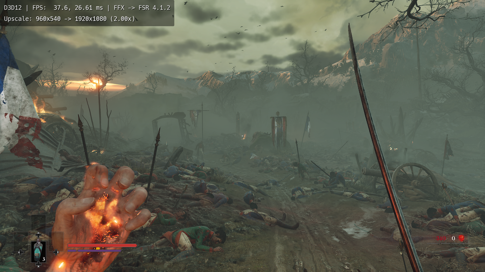
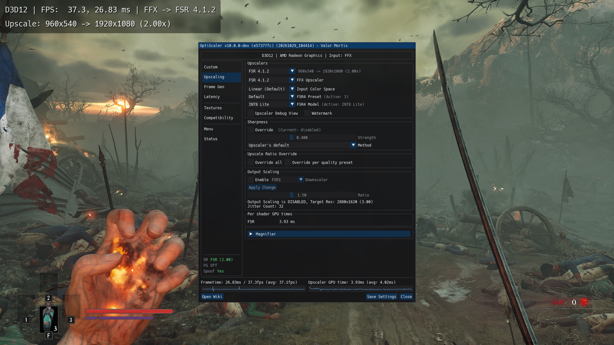

<p align="center">
  
</p>

<p align="center">
  <a href="https://github.com/db1522/fsr4-lite-rog-ally/releases/latest"></a>
  <a href="https://github.com/db1522/fsr4-lite-rog-ally/releases"></a>
  
  
</p>
<p align="center">
  
  
  
</p>

<p align="center">
  <b>FSR 4.1.2 Lite in any game on your ROG Ally, ROG Ally X or other AMD handheld. One tap, from Game Bar.</b><br/>
  A free Xbox Game Bar widget by <a href="https://rogallylife.com">ROG Ally Life</a>.
</p>

<p align="center">
  <a href="https://github.com/db1522/fsr4-lite-rog-ally/releases/latest/download/FSR4Lite_x64.zip"><b>⬇ Download</b></a> ·
  <a href="https://rogallylife.com/2026/10/26/fsr-4-1-2-lite-on-the-rog-ally/">Full guide</a> ·
  <a href="#install">Install</a> ·
  <a href="#tested-games">Tested games</a> ·
  <a href="#faq">FAQ</a> ·
  <a href="https://ko-fi.com/rogallylife">Support on Ko-fi</a>
</p>

---

AMD's FSR 4.1 arrived on the ROG Xbox Ally X as an official preview, and the original ROG Ally and ROG Ally X were
left out. You can run FSR 4.1.2 Lite on them through OptiScaler, but by hand that means copying files, renaming a DLL,
editing an ini file and picking the model in an in-game menu, for every game.

**FSR 4.1 Lite does all of that for you.** Open Game Bar over a game, press **Install FSR 4.1 Lite**, restart the
game, and pick its upscaler. That's it.

<p align="center">
  
</p>

## What you get

- **One-tap install per game.** It finds the right folder (including Unreal Engine's `Binaries\Win64`) and sets
  everything up, with no OptiScaler menu to open.
- **FSR, DLSS and XeSS games.** Whichever upscaler the game offers, including FSR 2 and games with no FSR at all,
  becomes FSR 4.1.2 Lite.
- **Any store.** Steam, Epic, GOG, Ubisoft Connect, the EA app, Battle.net and Game Pass. It works from the running
  game, so the launcher doesn't matter.
- **A live status badge.** Green **FSR 4.1 Lite active** only once the game has really loaded the Lite model, with
  the live render resolution, for example `Rendering 960x540 → 1920x1080`.
- **Community compatibility at a glance.** Each game card shows which upscalers work in that game, from OptiScaler's
  community Compatibility List.
- **Capcom RE Engine games handled.** Games that need REFramework for OptiScaler to work, like Resident Evil Requiem,
  Monster Hunter Wilds, Dragon's Dogma 2, Onimusha: Way of the Sword and PRAGMATA, get REFramework installed
  automatically too.
- **DLSS shown where AMD needs help.** Some games, like DOOM Eternal, only offer DLSS on AMD with OptiPatcher. Games
  the Compatibility List marks for it get OptiPatcher installed automatically, so FSR 4.1 Lite can take over DLSS.
- **Always up to date.** OptiScaler's newest build and the FSR 4.1.2 Lite files download by themselves, and your
  installed games update automatically, each keeping its own settings.
- **Notifications.** A notification confirms FSR 4.1 Lite each time a game starts with it, or tells you what to fix.
- **Frame generation, experimental.** One switch on the game card adds OptiScaler's frame generation to DirectX 12
  games, starting from recommended settings for tested games. See [Frame generation](#frame-generation-experimental).
- **Nothing on screen you didn't ask for.** No startup message, no watermark. An optional FPS and resolution overlay
  is one switch away, in six sizes from Small to Maximum and any of the four corners.
- **Clean uninstall.** Remove it from one game or all of them, and every game folder goes back exactly as it was.

## Install

1. **[Download FSR4Lite_x64.zip](https://github.com/db1522/fsr4-lite-rog-ally/releases/latest/download/FSR4Lite_x64.zip)**
   and unzip it.
2. Double-click **Install.cmd**. Windows asks for administrator permission once, to trust the ROG Ally Life
   certificate. The widget is free, so it's signed with ROG Ally Life's own certificate rather than a paid one.
3. Open Game Bar (the **Xbox** button on the ROG Xbox Ally and Ally X, the **Armoury Crate** button on the ROG Ally
   and Ally X, **Win + G** elsewhere), open the **Widgets** menu and pick **FSR 4.1 Lite**. Pin it to keep it close.

The first time it opens, the widget downloads OptiScaler and the FSR 4.1.2 Lite files on its own.

**Updating:** the widget updates itself. Setup shows your installed version, a **Check for updates** button, and an
**Update** button whenever a new version is out. While it installs, Game Bar closes for a few seconds and a notification
tells you when it's done; open Game Bar again to use the new version. Your settings and installed games carry over.

## Use it in a game

1. Start the game, open Game Bar and the widget. It picks up the game you're playing.
2. Press **Install FSR 4.1 Lite**.

   

3. Restart the game and turn on its upscaler. Pick **FSR** when the card says FSR was found; if it tells you to pick
   **DLSS** or **XeSS**, use that, because that game's FSR is built in.

Once it's running, the badge turns green and a notification confirms it.

**Want proof on screen?** The widget's **Show FPS and render resolution in game** switch adds a small overlay in the
corner, and pressing **Insert** in the game opens OptiScaler's menu, where the FSR4 model reads **INT8 Lite**.

<p align="center">
  
</p>

<details>
<summary><strong>OptiScaler's menu, for the full detail</strong></summary>
<br>
<p align="center">
  
</p>
</details>

> [!TIP]
> If the card says a game is rendering at full resolution, change the game's resolution once and back. Some games,
> like Forza Horizon 6, only apply their upscaler preset after a resolution change.

## Frame generation (experimental)

For DirectX 12 games with FSR 4.1 Lite installed, the game card has an **Experimental** section (not for Vulkan
games such as Enshrouded, where it stops the Lite model from loading). Its **Frame
generation** switch turns on OptiScaler's frame generation, which adds generated frames between the real ones for
smoother motion.

1. Open **Experimental** on the game card and turn on **Frame generation**.
2. **Restart the game.** OptiScaler only reads its frame generation settings when a game starts, so an amber reminder
   stays on the card until you restart.
3. Once it's running, a green **Frame generation active** badge appears on the card.

The widget picks the right method for each game, following OptiScaler's own advice:

| The game has... | Method | What to do |
| --- | --- | --- |
| Its own FSR frame generation | None needed | Turn it on in the game's graphics settings; it works alongside FSR 4.1 Lite |
| DLSS frame generation | The game's DLSS frame generation, through OptiScaler | Also turn on DLSS frame generation in the game |
| No frame generation | OptiFG, OptiScaler's own frame generation | Nothing else |

**Output:** choose **FSR (more FPS)**, the default, or **XeSS (cleaner image)**. XeSS needs borderless or windowed
fullscreen, and one extra restart the first time.

**Fine-tune (OptiFG):** if menus or subtitles smear, try a higher **HUDFix limit** or **Immediate Capture**, then
restart the game. **Reset to recommended** goes back to the game's recommended settings.

**Recommended settings:** games tested by ROG Ally Life, or covered on OptiScaler's wiki, start with their best
settings, for example XeSS for Control. The list is
[`data/framegen-presets.json`](data/framegen-presets.json) and updates without a new widget version. Games where
OptiScaler's HUD fix can't work, from OptiScaler's own list, show a warning on the card.

**Unreal Engine games** using OptiFG with DLSS get OptiScaler's recommended fix for smearing
(`r.NGX.DLSS.DilateMotionVectors=0` in the game's `Engine.ini`), removed again when you turn frame generation off.

Your controller and the Steam overlay keep working with frame generation on. Turning the switch off or uninstalling
turns frame generation off and undoes every change it made.

## Tested games

Confirmed on ROG Ally hardware:

| Game | Store | Upscaler picked in the game |
| --- | --- | --- |
| Forza Horizon 6 | Steam | FSR |
| 007 First Light | Steam | FSR |
| Ghost of Tsushima | Steam | FSR |
| God of War | Steam | FSR 2.0 |
| Control Ultimate Edition | Steam | DLSS (the game has no FSR) |
| Resident Evil Requiem | Steam | FSR (REFramework added automatically) |
| Monster Hunter Wilds | Steam | FSR (REFramework added automatically) |
| Dragon's Dogma 2 | Steam | FSR (REFramework added automatically) |
| Red Dead Redemption 2 | Steam | FSR 2 (set the game to DirectX 12; installed as winmm.dll automatically) |
| Palworld | Steam | DLSS (add `-dx12` to Palworld's launch options) |
| Enshrouded | Steam | DLSS (Vulkan; if DLSS isn't listed, turn the upscaler off and restart the game) |
| The Witcher 3: Wild Hunt | Steam | FSR (the game's own frame generation works alongside it) |
| Valor Mortis | Game Pass | FSR |
| Forza Motorsport | Game Pass | DLSS |
| No Man's Sky | Game Pass | DLSS (its FSR is built into the game) |

Hundreds more games work with OptiScaler; see the community
[Compatibility List](https://github.com/optiscaler/OptiScaler/wiki/Compatibility-List).

## Supported handhelds

Support is decided by the graphics chip, so it isn't limited to ROG hardware.

| | Handhelds |
| --- | --- |
| ✅ **Supported** | ROG Ally, ROG Ally X, ROG Xbox Ally, Legion Go, Legion Go S, Legion Go 2, MSI Claw A8, and GPD, AYANEO and OneXPlayer handhelds with Ryzen 7040/8040 or Ryzen AI 300 chips |
| ✅ **Supported, with a note** | ROG Xbox Ally X / X20. ASUS's Armoury Crate FSR 4.1 toggle only upgrades games with FSR 3.1 or newer; the widget also covers DLSS, XeSS and FSR 2 games. The widget's note about this can be hidden |
| ⚠️ **Experimental** | Steam Deck on Windows and other RDNA 2 handhelds. Lite runs, but can be slower than FSR 3 on these chips |
| ❌ **Not supported** | Handhelds without AMD graphics, such as Intel-based MSI Claw models |

## Anti-cheat and online games

FSR 4.1 Lite works by loading OptiScaler into the game, and anti-cheat treats that as a possible cheat, which can get
your account banned. The widget checks every game before installing and refuses when it finds Easy Anti-Cheat,
BattlEye, EA Javelin, Ricochet, nProtect GameGuard, XIGNCODE3, Anti-Cheat Expert, EQU8, PunkBuster or HoYoverse's
anti-cheat, and it recognises games protected by Riot Vanguard, Valve Anti-Cheat and Blizzard by name.

> [!WARNING]
> No list catches everything. **Use FSR 4.1 Lite in single-player games only**, and don't install it into anything
> you play online.

**Why a single-player campaign can still be blocked:** many games start their anti-cheat every time they launch,
before you pick a mode. Gears of War: E-Day is one: on Steam it always starts through Easy Anti-Cheat's launcher, and
the anti-cheat service runs even for the offline campaign. The block stays for those games.

## Current limitations

- **Image quality first.** FSR 4.1.2 Lite costs more GPU time than FSR 3, so at the same preset it can be a little
  slower. A lower preset with Lite usually looks as good as or better than FSR 3 at a higher one.
- **The game needs an upscaler:** FSR 2, FSR 3, DLSS or XeSS. FSR 1 can't be upgraded.
- **Some games need one extra restart.** If a game, often a Game Pass one, skips OptiScaler, the widget sets it up a
  different way by itself and a notification asks you to restart the game. Games in Windows' protected WindowsApps
  folder can't be changed.
- **Most testing happens on ROG Ally hardware.** Other AMD handhelds are supported by chip.
- **RivaTuner (RTSS) can crash some games** together with OptiScaler, Red Dead Redemption 2 among them. If a game
  crashes at startup, close RTSS (or MSI Afterburner) and try again.
- **OptiScaler nightlies** update automatically and can occasionally break a game. If that happens, turn off
  **Update games automatically** and let me know.
- **Frame generation is experimental.** OptiFG adds frame generation to games that never had it, and some games
  crash or show HUD ghosting with it. Turn it off on the card if a game misbehaves.
- **Notifications during fullscreen games** are held by Windows unless you add FSR 4.1 Lite under Settings > System >
  Notifications > Set priority notifications.

## Uninstall

- **One game:** while you play it, press **Uninstall when the game closes** on its card; Windows locks the files
  until then, and FSR 4.1 Lite is removed the moment you quit. Or open **Installed in**, select the game and confirm.
- **Everything:** press **Uninstall FSR 4.1 Lite** at the bottom of the widget. It restores every game folder, then
  opens Windows Settings for the final click.

> [!IMPORTANT]
> Use the button rather than uninstalling from Settings first, or OptiScaler stays behind in your game folders.

## FAQ

<details>
<summary><strong>Is it safe?</strong></summary>

It only downloads OptiScaler's official builds from OptiScaler's GitHub, unmodified, and AMD's FSR 4.1.2 files, which
must pass a check that they're signed, unmodified AMD driver files or they're discarded. Every file it adds to a game
is recorded, and anything it replaces is backed up, so uninstalling restores the folder byte for byte. It never
installs into Windows, launchers or the Xbox app.
</details>

<details>
<summary><strong>Do I still need it on the ROG Xbox Ally X?</strong></summary>

ASUS's Armoury Crate toggle covers games that ship FSR 3.1 or newer. FSR 4.1 Lite also covers games that only offer
DLSS (like Control), XeSS or FSR 2 (like God of War).
</details>

<details>
<summary><strong>Why does Windows ask for administrator permission?</strong></summary>

Once per install, to trust the ROG Ally Life certificate the widget is signed with. A paid code-signing certificate
would skip this; the widget is free, so it uses its own.
</details>

<details>
<summary><strong>My game says "Restart the game to load it" after I restarted.</strong></summary>

Some games, often Game Pass ones, skip the file OptiScaler starts from. About 30 seconds into the game, the widget
notices, sets FSR 4.1 Lite up a different way and asks you to restart the game. If that happens more than once, it's
trying the next way each time; it remembers the one that works. You can also press **Try another loader** on the card
to switch straight away.
</details>

<details>
<summary><strong>Does frame generation work with it?</strong></summary>

Yes. If your game has its own FSR frame generation, turn it on in the game's graphics settings as usual. It works
alongside FSR 4.1.2 Lite, so you get the sharper upscaling and smoother motion together. For other DirectX 12 games,
use the **Experimental** section on the game card; see [Frame generation](#frame-generation-experimental).
</details>

<details>
<summary><strong>A game crashes at startup after installing.</strong></summary>

Close RivaTuner (RTSS) or MSI Afterburner if they're running, since they can clash with OptiScaler. If it still
crashes, press **Try another loader** on the game's card (or **Uninstall** under **Installed in**), and check the game's
row on OptiScaler's [Compatibility List](https://github.com/optiscaler/OptiScaler/wiki/Compatibility-List) for any
game-specific setting, such as DirectX 12.
</details>

<details>
<summary><strong>Something isn't working. How do I report it?</strong></summary>

Open the widget (over the game, if it's about one game) and press **Create support report** in Setup. It saves a file
to your Desktop with the logs and settings needed to help, with your Windows user name removed. Send it to
[contact@rogallylife.com](mailto:contact@rogallylife.com), or attach it to a
[GitHub issue](https://github.com/db1522/fsr4-lite-rog-ally/issues).
</details>

## Credits

FSR 4.1 Lite is the front end. The upscaling is done by **[OptiScaler](https://github.com/optiscaler/OptiScaler)**, the
free, open-source tool created by **cdozdil** and the OptiScaler contributors, released under GPL-3.0. The widget
downloads their official [nightly builds](https://github.com/optiscaler/OptiScaler-nightly) unmodified. If FSR 4.1 Lite
helps you, please consider [supporting the OptiScaler developer](https://github.com/sponsors/cdozdil).

FSR 4 is by AMD. Thanks to **TheRazerMD** for sharing the FSR 4.1.2 Lite driver files, to the OptiScaler community
for the [Compatibility List](https://github.com/optiscaler/OptiScaler/wiki/Compatibility-List) shown on game cards, and
to **praydog** for [REFramework](https://github.com/praydog/REFramework), which RE Engine games need, and to the
OptiScaler team for [OptiPatcher](https://github.com/optiscaler/OptiPatcher) (MIT licence), which shows DLSS on AMD in
the games that need it. Both are downloaded from their official releases on your device, never bundled.

<p align="center">
  <strong>FSR 4.1 Lite is free and always will be.</strong><br />
  If it saves you time, you can <a href="https://ko-fi.com/rogallylife">support ROG Ally Life on Ko-fi</a>.<br /><br />
  <a href="https://rogallylife.com">rogallylife.com</a> · tested settings guides for the ROG Ally family
</p>

---

## For developers

<details>
<summary><strong>How it works</strong></summary>

The package holds two programs:

- **RalFsr.Widget**, a UWP Game Bar widget. It is only the interface.
- **RalFsr.Host**, a full-trust helper. It finds the game under the overlay, downloads OptiScaler and the FSR 4 files,
  installs and removes files, and talks to the widget over an in-package app service. It runs a Windows message loop
  and exits when Windows asks programs to close, so installers (such as Xbox Service's repair) never wait on it. With
  notifications on, it also starts with Windows as a small watcher.

When you install into a game, the helper:

1. Finds the game window under Game Bar and the folder holding its exe (`<Project>\Binaries\Win64` or `WinGDK` for
   Unreal Engine games). Launchers, the Xbox app and Windows apps are never treated as games.
2. Blocks games with anti-cheat, and leaves alone games with a manual OptiScaler install.
3. Copies the current OptiScaler nightly into that folder, with `OptiScaler.dll` renamed to a loader name (see
   [Loader names](#loader-names)), usually `dxgi.dll`.
4. Copies the FSR 4.1.2 files (`amdxcffx64.dll`, `amdvkffx64.dll`) into the `OptiScaler` subfolder.
5. Writes `OptiScaler.ini`: `Dx12Upscaler=ffx`, `Dx11Upscaler=ffx_12`, `VulkanUpscaler=ffx_12` (Vulkan through the
   DX12 bridge, where FSR 4.1.2 is listed first), `Fsr4GpuSupport=4` and `Fsr4Model=3` (INT8 Lite), frame generation
   off, `DisableSplash=true` and `Fsr4EnableWatermark=false`. FSR 2 games also get `UseFsr2Dx11Inputs` or
   `UseFsr2VulkanInputs` for their graphics API, and games with no upscaler files get `Fsr2Pattern` / `Fsr3Pattern`.
6. Records every added or replaced file in `.ralfsr\manifest.json`, with backups, so Uninstall restores the folder
   exactly.

Values live in `src\Core\InstallConfig.cs`; anti-cheat lists in `src\Core\GameAnalyzer.cs`.

**Status badge.** The helper reads the running game's loaded DLLs and `OptiScaler.log` (Info level, fresh each
session). Green means the widget's own FSR 4.1.2 file is loaded and the log shows the Lite model hooked. The render
resolution comes from Streamline's `color_in extents` when present (the size really handed over), otherwise from
OptiScaler's feature setup.

<a id="loader-names"></a>**Loader names.** OptiScaler starts from a DLL with a Windows name the game loads from its own
folder: `dxgi.dll`, `winmm.dll`, `version.dll`, `dbghelp.dll`, `d3d12.dll`, `wininet.dll` or `winhttp.dll`, never one
the game ships. The first name is, in order: the game's rule (`winmm.dll` for Red Dead Redemption 2), the name that
worked the last time the game was installed, for Game Pass games whose exe doesn't import `dxgi.dll` a name it does
import (read from the exe's import table, since Windows loads those from the game folder at startup), else `dxgi.dll`.
When the game's own exe runs for 30 seconds with its graphics started and no process from its folder has loaded
OptiScaler, the helper renames the loader to the next untried name (names the exe imports first), records the skipped
names in the install record and asks for a restart; with none left it says the game can't be set up. A name that then
works is remembered per exe. Frame generation settings are kept through a switch.

**Frame generation.** Written into `OptiScaler.ini` from `src\Core\FrameGen.cs` (key names checked against the v10
nightly's `OptiScaler.ini`): `[FrameGen] Enabled, FGInput, FGOutput, FGNvngxReplacement`, `[OptiFG] HUDFix, HUDLimit,
HUDFixImmediate` and `[Hotfix] DisableOverlays`. Inputs follow the priority on OptiScaler's Frame-Generation-Options
page: `FGInput=dlssg` (with `Enabled=auto`, following the game's own DLSS frame generation switch) for games that ship
`nvngx_dlssg.dll` or `sl.dlss_g.dll`, Nukem's (`FGInput=nvngxfg`, `FGNvngxReplacement=Nukems`) for the wiki's Streamline
1 games, and OptiFG (`FGInput=upscaler`) otherwise. `DisableOverlays=false`, because OptiScaler's default with OptiFG
also blocks Steam Input; OptiScaler still blocks the Epic overlay by itself. Off is `Enabled=false` with `nofg` input
and output. Per-game recommendations come from `data\framegen-presets.json` (built in, and read from GitHub every 6 hours;
the copy with the higher `version` wins) and the HUDFix-incompatible list from OptiScaler's wiki (daily). The badge
reads `OptiScaler.log`: FSR frame generation counts as running after `FSRFG_Dx12::CreateContext D3D12_CreateContext
result: 0` or `D3D12_Configure Enabled: true`, XeSS after `SetEnabled: true`, until a matching off line.

**REFramework.** For games whose Compatibility List entry says "Requires REFramework", the widget adds
[REFramework](https://github.com/praydog/REFramework-nightly)'s `dinput8.dll` next to the exe. It comes from praydog's
official nightly `REFramework.zip` (one build for every supported RE Engine game; only `dinput8.dll` is used, as its
release notes advise without VR), checked once a day through the permanent `latest/download` link. A game that already
has its own `dinput8.dll` is left alone. Uninstall removes REFramework and the files it created while running (its
`reframework` folder, config and log) unless they were there before. REFramework updates along with OptiScaler. Because REFramework and OptiScaler both use Insert for their menus,
these games get OptiScaler's menu on Home (`ShortcutKey=0x24`). REFramework opens its menu on every launch by default,
so the widget sets `REFrameworkConfig_RememberMenuState=true` and `REFrameworkConfig_MenuOpen=false` in
`re2_fw_config.txt` (games it set REFramework up for only) and it starts closed; Insert still opens it. OptiScaler's own game profiles already apply the other
settings these games need (`RestoreComputeSignature=true`, `Dxgi=false`).

**OptiPatcher.** For games the Compatibility List marks with ✨, the widget adds
[OptiPatcher](https://github.com/optiscaler/OptiPatcher), OptiScaler's official ASI plugin, which makes the game show
DLSS on AMD without spoofing an NVIDIA card. It goes in the plugins folder OptiScaler reads (`OptiScaler\plugins\OptiPatcher.asi`)
with `[Plugins] LoadAsiPlugins=true`. It's the newest published release from GitHub's API, checked against the
asset's SHA-256 digest and refused if it isn't a Windows DLL, downloaded the first time a game needs it and checked for
updates once a day; if GitHub's API can't be reached, the pinned v0.42 is used. Games set up earlier get it with the
automatic game updates, which also put it back if a game update removes it. Uninstall removes it, and the plugins
folder if the widget made it and it's empty; the player's own files in that folder are never touched.

**Widget updates.** The helper reads the newest release from the redirect of
`github.com/db1522/fsr4-lite-rog-ally/releases/latest` (no GitHub API, so no rate limit) whenever the widget is
opened (at most every 30 minutes) and every 6 hours in the background, and compares it with the installed package
version. Updating downloads that release's `FSR4Lite_x64.zip` into
`%ProgramData%\ROGAllyLife\FSR4LiteUpdate` (no spaces) and runs its `install.ps1` outside the widget's package:
Explorer opens a small `Update.cmd` that starts itself minimized, writes the installer's output to `install.log`, and
closes itself. (Task Scheduler was tried first, but on some devices the task never ran.) The widget follows that log
live (download percentage, certificate, install), reports failures with Try again, and confirms the new version after
it reopens. The installer closes the widget's own processes before installing, so Windows doesn't relaunch the widget
as a full-screen app afterwards, and the widget never opens as a full-screen app: launched outside Game Bar, it opens
Game Bar instead (or just closes right after an update). After an update the widget tries up to three times to start
its helper.

**Overlay size and position.** Each overlay size (Small, Medium, Large, Extra large, Huge, Maximum) is a fixed share
of the game's screen height for its text: 1.5, 2.0, 2.6, 3.3, 4.1 and 5.0 percent, so every step is about a quarter to a
third bigger than the last on any handheld, docked screen or resolution. The height is the game window's own, read
while the game runs under Game Bar and remembered per game (the screen's resolution before the first run). With
OptiScaler builds that read `FpsOverlayFontSize`, the widget sets the font to the text size itself (8 to 48 px), so it
stays sharp, and `FpsScale` only takes it past 48 px; older builds get `FpsScale` alone, times the 14 px menu font,
within OptiScaler's 0.5 to 3.0 range. Large, the default, is about 28 px at 1080p.
**Overlay position** puts it in any corner (`FpsOverlayPos` 0 to 3), for example away from a game's own HUD.

**Support report.** Setup's **Create support report** saves `FSR4Lite-report-<date>.zip` to the Desktop: a
`summary.txt` (device, versions, settings, installed games, the current game's card text, install record and
OptiScaler errors), the last 3,000 lines of `helper.log` and `widget.log`, and for the current game its
`OptiScaler.log`, every frame generation line from the whole log (`OptiScaler-framegen.log`), `OptiScaler.ini`,
install record and a list of the file names in its folder. `summary.txt` also lists the game's frame generation
settings. The Windows user name is
replaced with `<user>`, and nothing is sent anywhere.

**Updates.** OptiScaler: looked for when the widget opens and hourly, GitHub asked at most every 6 hours. FSR 4
files: ETag check against ROG Ally Life's R2 bucket once a day, with a GitHub release (db1522/fsr4-files) as the
fallback source. Compatibility list: raw wiki Markdown once a day. Game updates
copy the new OptiScaler package over the old one, keep each game's loader name and never replace `OptiScaler.ini`.

**Network access:** OptiScaler's GitHub releases, ROG Ally Life's R2 bucket (FSR 4 files), OptiScaler's wiki
(compatibility list and the HUDFix-incompatible list), this repository's `data/framegen-presets.json` and
REFramework's and OptiPatcher's GitHub releases (only for games that need them). Nothing else, and no telemetry.
</details>

<details>
<summary><strong>Building and releasing</strong></summary>

**Signing.** For a permanent certificate (players approve it once, ever), run
`tools\SigningCertificate\Create certificate.cmd` once on your PC and paste the two values it produces into the repo's
Actions secrets `SIGNING_PFX_BASE64` and `SIGNING_PFX_PASSWORD`. Keep the `.pfx` it creates private. Without those
secrets, each build gets a fresh certificate and players approve every update.

GitHub builds, signs and packages the widget. Publish a release with a new tag (`v1.2.3` style, always higher than the last) and
**FSR4Lite_x64.zip** is attached a few minutes later; progress and errors show in the Actions tab. Each build is
signed with a fresh self-signed `CN=ROG Ally Life` certificate; updates install over older versions because Windows
matches the publisher name.

To build locally: Visual Studio 2022 with the Universal Windows Platform workload and the .NET 8 SDK, then
`powershell -ExecutionPolicy Bypass -File .\scripts\build.ps1`. Output: `dist\FSR4Lite_x64.zip`.

The build registers the Game Bar SDK's private interfaces in the package manifest from the restored SDK
(`tools\GameBarProxyStub`). Without all of them, Game Bar shows "something isn't playing nice".

Logs: `widget.log` in `%LOCALAPPDATA%\Packages\ROGAllyLife.FSR4Lite_<id>\LocalState`, and `helper.log` in
`...\LocalCache\Local\RAL FSR Helper`.
</details>

<details>
<summary><strong>Project layout</strong></summary>

```
RALFsr4Lite.sln
.github\workflows\release.yml   GitHub build: publish a release, get the zip
scripts\build.ps1               build, sign and zip a release
src\Installer\                  user installer, copied into the zip as Install.cmd
tools\GameBarProxyStub\         registers the Game Bar SDK's interfaces in the manifest
src\Core\                       install engine (no UI)
src\RalFsr.Host\                full-trust helper: app service, detection, downloads, updates
src\RalFsr.Widget\              Game Bar widget (UWP)
data\framegen-presets.json      recommended frame generation settings per game (read online too)
```
</details>
