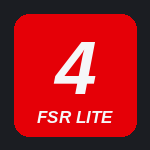

<p align="center">
  
</p>

<h1 align="center">FSR 4.1 Lite by ROG Ally Life</h1>

<p align="center">
  <strong>FSR 4.1.2 Lite in any game on your ROG Ally, ROG Ally X or other AMD handheld. One tap, from Game Bar.</strong>
</p>

<p align="center">
  <a href="https://github.com/db1522/fsr4-lite-rog-ally/releases/latest/download/FSR4Lite_x64.zip"></a>
  <a href="https://github.com/db1522/fsr4-lite-rog-ally/releases/latest"></a>
  <a href="https://github.com/db1522/fsr4-lite-rog-ally/releases"></a>
</p>

<p align="center">
  <a href="https://rogallylife.com/2026/10/25/fsr-4-1-2-lite-on-the-rog-ally/">Full guide on ROG Ally Life</a> ·
  <a href="#install">Install</a> ·
  <a href="#tested-games">Tested games</a> ·
  <a href="#faq">FAQ</a> ·
  <a href="https://ko-fi.com/rogallylife">Support on Ko-fi</a>
</p>

---

AMD's FSR 4.1 arrived on the ROG Xbox Ally X as an official preview, and the original ROG Ally and ROG Ally X were
left out. You can run FSR 4.1.2 Lite on them through OptiScaler, but by hand that means copying files, renaming a DLL,
editing an ini file and picking the model in an in-game menu, for every game.

**FSR 4.1 Lite does all of that for you.** Open Game Bar over a game, press **Install FSR 4.1 Lite**, restart the
game, and pick its upscaler. That's it.

<!-- Screenshot suggestion: docs/widget.png, the widget over a game with the green "FSR 4.1 Lite active" badge -->

## What you get

- **One-tap install per game.** It finds the right folder (including Unreal Engine's `Binaries\Win64`) and sets
  everything up, with no OptiScaler menu to open.
- **FSR, DLSS and XeSS games.** Whichever upscaler the game offers, including FSR 2 and games with no FSR at all,
  becomes FSR 4.1.2 Lite.
- **Any store.** Steam, Epic, GOG, Ubisoft Connect, the EA app, Battle.net and Game Pass. It works from the running
  game, so the launcher doesn't matter.
- **A live status badge.** Green **FSR 4.1 Lite active** only once the game has really loaded the Lite model, with
  the live render resolution, for example `Rendering 960x540 → 1920x1080`.
- **Community compatibility at a glance.** Each game card shows which upscalers work in that game, from OptiScaler's
  community Compatibility List.
- **Capcom RE Engine games handled.** Games that need REFramework for OptiScaler to work, like Resident Evil Requiem,
  Monster Hunter Wilds, Dragon's Dogma 2, Onimusha: Way of the Sword and PRAGMATA, get REFramework installed
  automatically too.
- **Always up to date.** OptiScaler's newest build and the FSR 4.1.2 Lite files download by themselves, and your
  installed games update automatically, each keeping its own settings.
- **Notifications.** A notification confirms FSR 4.1 Lite each time a game starts with it, or tells you what to fix.
- **Nothing on screen you didn't ask for.** No startup message, no watermark. An optional FPS and resolution overlay
  is one switch away, in six sizes from Small to Maximum and any of the four corners.
- **Clean uninstall.** Remove it from one game or all of them, and every game folder goes back exactly as it was.

## Install

1. **[Download FSR4Lite_x64.zip](https://github.com/db1522/fsr4-lite-rog-ally/releases/latest/download/FSR4Lite_x64.zip)**
   and unzip it.
2. Double-click **Install.cmd**. Windows asks for administrator permission once, to trust the ROG Ally Life
   certificate. The widget is free, so it's signed with ROG Ally Life's own certificate rather than a paid one.
3. Open Game Bar (the **Armoury Crate** button on ROG handhelds, **Win + G** elsewhere), open the **Widgets** menu
   and pick **FSR 4.1 Lite**. Pin it to keep it close.

The first time it opens, the widget downloads OptiScaler and the FSR 4.1.2 Lite files on its own.

**Updating the widget:** Setup shows your installed version. When a new release is out, it shows **Update to x.y.z**:
tap it, and the widget closes for a moment while the update installs, then reopen it from Game Bar. Your settings and
installed games carry over. Windows may ask for administrator permission during the update. (Versions before the
built-in updater: download the new zip and run its Install.cmd once.)

## Use it in a game

1. Start the game, open Game Bar and the widget. It picks up the game you're playing.
2. Press **Install FSR 4.1 Lite**.
3. Restart the game and turn on its upscaler. Pick **FSR** when the card says FSR was found; if it tells you to pick
   **DLSS** or **XeSS**, use that, because that game's FSR is built in.

Once it's running, the badge turns green and a notification confirms it.

**Want proof on screen?** Press **Insert** in the game to open the OptiScaler menu: the FSR4 model reads
**INT8 Lite**. The widget's **Show FPS and render resolution in game** switch adds a small overlay too.

> [!TIP]
> If the card says a game is rendering at full resolution, change the game's resolution once and back. Some games,
> like Forza Horizon 6, only apply their upscaler preset after a resolution change.

## Tested games

Confirmed on the ROG Ally X:

| Game | Store | Upscaler picked in the game |
| --- | --- | --- |
| Forza Horizon 6 | Steam | FSR |
| 007 First Light | Steam | FSR |
| Ghost of Tsushima | Steam | FSR |
| God of War | Steam | FSR 2.0 |
| Control Ultimate Edition | Steam | DLSS (the game has no FSR) |
| Resident Evil Requiem | Steam | FSR (REFramework added automatically) |
| Monster Hunter Wilds | Steam | FSR (REFramework added automatically) |
| Dragon's Dogma 2 | Steam | FSR (REFramework added automatically) |
| Valor Mortis | Game Pass | FSR |
| Forza Motorsport | Game Pass | DLSS |
| No Man's Sky | Game Pass | DLSS (its FSR is built into the game) |

Hundreds more games work with OptiScaler; see the community
[Compatibility List](https://github.com/optiscaler/OptiScaler/wiki/Compatibility-List).

## Supported handhelds

Support is decided by the graphics chip, so it isn't limited to ROG hardware.

| | Handhelds |
| --- | --- |
| ✅ **Supported** | ROG Ally, ROG Ally X, Legion Go, Legion Go 2, MSI Claw A8, and GPD, AYANEO and OneXPlayer handhelds with Ryzen 7040/8040 or Ryzen AI 300 chips |
| ✅ **Supported, with a note** | ROG Xbox Ally X / X20. ASUS's Armoury Crate FSR 4.1 toggle only upgrades games with FSR 3.1 or newer; the widget also covers DLSS, XeSS and FSR 2 games |
| ⚠️ **Experimental** | ROG Xbox Ally, Legion Go S, Steam Deck on Windows and other RDNA 2 handhelds. Lite runs, but can be slower than FSR 3 on these chips |
| ❌ **Not supported** | Handhelds without AMD graphics, such as Intel-based MSI Claw models |

## Anti-cheat and online games

FSR 4.1 Lite works by loading OptiScaler into the game, and anti-cheat treats that as a possible cheat, which can get
your account banned. The widget checks every game before installing and refuses when it finds Easy Anti-Cheat,
BattlEye, EA Javelin, Ricochet, nProtect GameGuard, XIGNCODE3, Anti-Cheat Expert, EQU8, PunkBuster or HoYoverse's
anti-cheat, and it recognises games protected by Riot Vanguard, Valve Anti-Cheat and Blizzard by name.

> [!WARNING]
> No list catches everything. **Use FSR 4.1 Lite in single-player games only**, and don't install it into anything
> you play online.

## Current limitations

- **Image quality first.** FSR 4.1.2 Lite costs more GPU time than FSR 3, so at the same preset it can be a little
  slower. A lower preset with Lite usually looks as good as or better than FSR 3 at a higher one.
- **The game needs an upscaler:** FSR 2, FSR 3, DLSS or XeSS. FSR 1 can't be upgraded.
- **Some Game Pass games need a nudge.** If OptiScaler doesn't load after a restart, press **Try another loader**.
  Games in Windows' protected WindowsApps folder can't be changed.
- **Tested on the ROG Ally X so far.** Other AMD handhelds are supported by chip.
- **OptiScaler nightlies** update automatically and can occasionally break a game. If that happens, turn off
  **Update games automatically** and let me know.
- **Notifications during fullscreen games** are held by Windows unless you add FSR 4.1 Lite under Settings > System >
  Notifications > Set priority notifications.

## Uninstall

- **One game:** press **Uninstall from this game** on its card, or find it under **Installed in**.
- **Everything:** press **Uninstall FSR 4.1 Lite** at the bottom of the widget. It restores every game folder, then
  opens Windows Settings for the final click.

> [!IMPORTANT]
> Use the button rather than uninstalling from Settings first, or OptiScaler stays behind in your game folders.

## FAQ

<details>
<summary><strong>Is it safe?</strong></summary>

It only downloads OptiScaler's official builds from OptiScaler's GitHub, unmodified, and AMD's FSR 4.1.2 files, which
must pass a check that they're signed, unmodified AMD driver files or they're discarded. Every file it adds to a game
is recorded, and anything it replaces is backed up, so uninstalling restores the folder byte for byte. It never
installs into Windows, launchers or the Xbox app.
</details>

<details>
<summary><strong>Do I still need it on the ROG Xbox Ally X?</strong></summary>

ASUS's Armoury Crate toggle covers games that ship FSR 3.1 or newer. FSR 4.1 Lite also covers games that only offer
DLSS (like Control), XeSS or FSR 2 (like God of War).
</details>

<details>
<summary><strong>Why does Windows ask for administrator permission?</strong></summary>

Once per install, to trust the ROG Ally Life certificate the widget is signed with. A paid code-signing certificate
would skip this; the widget is free, so it uses its own.
</details>

<details>
<summary><strong>My game says "Restart the game to load it" after I restarted.</strong></summary>

Press **Try another loader** if it appears, then restart again. Some games, often Game Pass ones, ignore OptiScaler's
default loader name.
</details>

<details>
<summary><strong>Something isn't working. How do I report it?</strong></summary>

Email [contact@rogallylife.com](mailto:contact@rogallylife.com) with the game name and `helper.log`, found at
`%LOCALAPPDATA%\Packages\ROGAllyLife.FSR4Lite_...\LocalCache\Local\RAL FSR Helper\helper.log`. The game's own
`OptiScaler.log`, next to its exe, helps too.
</details>

## Credits

FSR 4.1 Lite is the front end. The upscaling is done by **[OptiScaler](https://github.com/optiscaler/OptiScaler)**, the
free, open-source tool created by **cdozdil** and the OptiScaler contributors, released under GPL-3.0. The widget
downloads their official [nightly builds](https://github.com/optiscaler/OptiScaler-nightly) unmodified. If FSR 4.1 Lite
helps you, please consider [supporting the OptiScaler developer](https://github.com/sponsors/cdozdil).

FSR 4 is by AMD. Thanks to **TheRazerMD** for sharing the FSR 4.1.2 Lite driver files, to the OptiScaler community
for the [Compatibility List](https://github.com/optiscaler/OptiScaler/wiki/Compatibility-List) shown on game cards, and
to **praydog** for [REFramework](https://github.com/praydog/REFramework), which RE Engine games need.

<p align="center">
  <strong>FSR 4.1 Lite is free and always will be.</strong><br />
  If it saves you time, you can <a href="https://ko-fi.com/rogallylife">support ROG Ally Life on Ko-fi</a>.<br /><br />
  <a href="https://rogallylife.com">rogallylife.com</a> · tested settings guides for the ROG Ally family
</p>

---

## For developers

<details>
<summary><strong>How it works</strong></summary>

The package holds two programs:

- **RalFsr.Widget**, a UWP Game Bar widget. It is only the interface.
- **RalFsr.Host**, a full-trust helper. It finds the game under the overlay, downloads OptiScaler and the FSR 4 files,
  installs and removes files, and talks to the widget over an in-package app service. It runs a Windows message loop
  and exits when Windows asks programs to close, so installers (such as Xbox Service's repair) never wait on it. With
  notifications on, it also starts with Windows as a small watcher.

When you install into a game, the helper:

1. Finds the game window under Game Bar and the folder holding its exe (`<Project>\Binaries\Win64` or `WinGDK` for
   Unreal Engine games). Launchers, the Xbox app and Windows apps are never treated as games.
2. Blocks games with anti-cheat, and leaves alone games with a manual OptiScaler install.
3. Copies the current OptiScaler nightly into that folder, with `OptiScaler.dll` renamed to `dxgi.dll` (or the next
   free loader name).
4. Copies the FSR 4.1.2 files (`amdxcffx64.dll`, `amdvkffx64.dll`) into the `OptiScaler` subfolder.
5. Writes `OptiScaler.ini`: `Dx12Upscaler=ffx`, `Dx11Upscaler=ffx_12`, `VulkanUpscaler=ffx_12` (Vulkan through the
   DX12 bridge, where FSR 4.1.2 is listed first), `Fsr4GpuSupport=4` and `Fsr4Model=3` (INT8 Lite), frame generation
   off, `DisableSplash=true` and `Fsr4EnableWatermark=false`. FSR 2 games also get `UseFsr2Dx11Inputs` or
   `UseFsr2VulkanInputs` for their graphics API, and games with no upscaler files get `Fsr2Pattern` / `Fsr3Pattern`.
6. Records every added or replaced file in `.ralfsr\manifest.json`, with backups, so Uninstall restores the folder
   exactly.

Values live in `src\Core\InstallConfig.cs`; anti-cheat lists in `src\Core\GameAnalyzer.cs`.

**Status badge.** The helper reads the running game's loaded DLLs and `OptiScaler.log` (Info level, fresh each
session). Green means the widget's own FSR 4.1.2 file is loaded and the log shows the Lite model hooked. The render
resolution comes from Streamline's `color_in extents` when present (the size really handed over), otherwise from
OptiScaler's feature setup.

**REFramework.** For games whose Compatibility List entry says "Requires REFramework", the widget adds
[REFramework](https://github.com/praydog/REFramework-nightly)'s `dinput8.dll` next to the exe. It comes from praydog's
official nightly `REFramework.zip` (one build for every supported RE Engine game; only `dinput8.dll` is used, as its
release notes advise without VR), checked once a day through the permanent `latest/download` link. A game that already
has its own `dinput8.dll` is left alone. Uninstall removes REFramework and the files it created while running (its
`reframework` folder, config and log) unless they were there before. REFramework updates along with OptiScaler. Because REFramework and OptiScaler both use Insert for their menus,
these games get OptiScaler's menu on Home (`ShortcutKey=0x24`). REFramework opens its menu on every launch by default,
so the widget sets `REFrameworkConfig_RememberMenuState=true` and `REFrameworkConfig_MenuOpen=false` in
`re2_fw_config.txt` (games it set REFramework up for only) and it starts closed; Insert still opens it. OptiScaler's own game profiles already apply the other
settings these games need (`RestoreComputeSignature=true`, `Dxgi=false`).

**Widget updates.** The helper reads the newest release from the redirect of
`github.com/db1522/fsr4-lite-rog-ally/releases/latest` (no GitHub API, so no rate limit) whenever the widget is
opened (at most every 30 minutes) and every 6 hours in the background, and compares it with the installed package
version. Updating downloads that release's `FSR4Lite_x64.zip` into
`%ProgramData%\ROG Ally Life\FSR4Lite-update`, then runs its `install.ps1` as a one-off scheduled task that deletes
itself, because installing closes the widget and helper. The installer's output goes to `install.log` there, and the
widget reports the result after it reopens.

**Overlay size and position.** The FPS and resolution overlay (Small, Medium, Large, Extra large, Huge, Maximum) takes
the same share of the
screen on every handheld, so bigger screens like the Legion Go's show bigger text. OptiScaler draws it in the game's
pixels and its own automatic scale follows the game's output height (1080p = 1.0, 1200p = 1.1, 1600p = 1.4); the
original fixed `FpsScale=0.8` ignored that and looked small on a 2560x1600 Legion Go. The widget now writes each game's
`FpsScale` from OptiScaler's rule for that game's output height (read from its last `OptiScaler.log`, or the screen's
resolution before the first run), times the chosen size, within OptiScaler's 0.5 to 3.0 range. Medium at 1080p (the
ROG Ally family) is still 0.8. It's OptiScaler's two-line Simple layout, so even Maximum stays well inside the screen.
**Overlay position** puts it in any corner (`FpsOverlayPos` 0 to 3), for example away from a game's own HUD.

**Updates.** OptiScaler: looked for when the widget opens and hourly, GitHub asked once a day. FSR 4 files: ETag
check against ROG Ally Life's R2 bucket once a day. Compatibility list: raw wiki Markdown once a day. Game updates
copy the new OptiScaler package over the old one, keep each game's loader name and never replace `OptiScaler.ini`.

**Network access:** OptiScaler's GitHub releases, ROG Ally Life's R2 bucket (FSR 4 files), OptiScaler's wiki
(compatibility list) and REFramework's GitHub releases (only for games that need it). Nothing else, and no telemetry.
</details>

<details>
<summary><strong>Building and releasing</strong></summary>

**Signing.** For a permanent certificate (players approve it once, ever), run
`tools\SigningCertificate\Create certificate.cmd` once on your PC and paste the two values it produces into the repo's
Actions secrets `SIGNING_PFX_BASE64` and `SIGNING_PFX_PASSWORD`. Keep the `.pfx` it creates private. Without those
secrets, each build gets a fresh certificate and players approve every update.

GitHub builds, signs and packages the widget. Publish a release with a new tag (`v1.0.3`, and so on) and
**FSR4Lite_x64.zip** is attached a few minutes later; progress and errors show in the Actions tab. Each build is
signed with a fresh self-signed `CN=ROG Ally Life` certificate; updates install over older versions because Windows
matches the publisher name.

To build locally: Visual Studio 2022 with the Universal Windows Platform workload and the .NET 8 SDK, then
`powershell -ExecutionPolicy Bypass -File .\scripts\build.ps1`. Output: `dist\FSR4Lite_x64.zip`.

The build registers the Game Bar SDK's private interfaces in the package manifest from the restored SDK
(`tools\GameBarProxyStub`). Without all of them, Game Bar shows "something isn't playing nice".

Logs: `widget.log` in `%LOCALAPPDATA%\Packages\ROGAllyLife.FSR4Lite_<id>\LocalState`, and `helper.log` in
`...\LocalCache\Local\RAL FSR Helper`.
</details>

<details>
<summary><strong>Project layout</strong></summary>

```
RALFsr4Lite.sln
.github\workflows\release.yml   GitHub build: publish a release, get the zip
scripts\build.ps1               build, sign and zip a release
src\Installer\                  user installer, copied into the zip as Install.cmd
tools\GameBarProxyStub\         registers the Game Bar SDK's interfaces in the manifest
src\Core\                       install engine (no UI)
src\RalFsr.Host\                full-trust helper: app service, detection, downloads, updates
src\RalFsr.Widget\              Game Bar widget (UWP)
```
</details>
